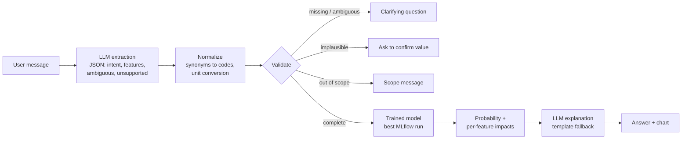

# 🫀 Heart Risk Assistant

An end-to-end ML application that estimates a patient's probability of heart disease from routine clinical measurements, with a natural-language interface. A care-team member types a patient description in plain English; an LLM extracts the clinical values, a model selected from tracked MLflow experiments makes the prediction, and the LLM explains the result and what drove it.

> **Not a medical device.** Educational and portfolio project. Predictions are statistical estimates from historical data, not diagnoses.

---

## 1. Project description

**What it does.** Turns a sentence like

> *"58-year-old man, asymptomatic, BP 140, cholesterol 289, fasting sugar normal, normal ECG, max HR 125, angina on exercise, oldpeak 1.5, flat ST slope"*

into a risk estimate ("high risk, ~97% probability") with a plain-language explanation of the factors that pushed the estimate up or down.

**Who it's for.** Clinicians, nurses, and care coordinators doing early cardiovascular risk triage, and informed patients reviewing results from a stress test. Several inputs (ST slope, oldpeak, max heart rate) come from an exercise ECG, so the tool is aimed at people who have those results in hand.

**Problem it solves.** Risk models usually require filling in rigid forms with coded values (`ChestPainType = ASY`). This app lets users describe the patient the way they would to a colleague, converts units and wording automatically, refuses to guess missing values, and explains the output instead of returning a bare number.

**Dataset.** [Heart Failure Prediction](https://www.kaggle.com/datasets/fedesoriano/heart-failure-prediction) (fedesoriano, Kaggle, 2021). 918 patients combined from five UCI heart disease cohorts (Cleveland, Hungary, Switzerland, Long Beach VA, Statlog). Target: `HeartDisease` (1 = heart disease). 11 features:

| Feature | Meaning | Type |
|---|---|---|
| Age | years | numeric |
| Sex | M / F | categorical |
| ChestPainType | TA typical angina, ATA atypical angina, NAP non-anginal pain, ASY asymptomatic | categorical |
| RestingBP | resting systolic blood pressure (mm Hg) | numeric |
| Cholesterol | serum cholesterol (mg/dL) | numeric |
| FastingBS | fasting blood sugar > 120 mg/dL (1/0) | binary |
| RestingECG | Normal, ST (ST-T wave abnormality), LVH (left ventricular hypertrophy) | categorical |
| MaxHR | maximum heart rate achieved on exercise | numeric |
| ExerciseAngina | exercise-induced angina (Y/N) | categorical |
| Oldpeak | ST depression induced by exercise relative to rest (mm) | numeric |
| ST_Slope | slope of peak exercise ST segment: Up, Flat, Down | categorical |

---

## 2. Setup

**Requirements:** Python 3.11+ (tested on 3.13 and 3.14), a [Nebius Token Factory](https://studio.nebius.com/) API key.

```bash
git clone https://github.com/evangundy/heart-risk-assistant.git
cd heart-risk-assistant
python -m venv .venv && source .venv/bin/activate     # Windows: .venv\Scripts\activate
pip install -r requirements.txt
```

**API key.** Keys are read only from environment variables, never from source code.

```bash
cp .env.example .env        # then edit .env and paste your NEBIUS_API_KEY
```

`NEBIUS_MODEL` and `NEBIUS_BASE_URL` are optional overrides. The default is `Qwen/Qwen3-235B-A22B-Instruct-2507`. Model availability varies by Nebius account; if you get a `PermissionDeniedError`, run `python check_llm.py` to list the models your key can use, and set `NEBIUS_MODEL` in `.env` to one of them.

**Get the data.** Data is not committed to Git (see `.gitignore`).

1. Download `heart.csv` from <https://www.kaggle.com/datasets/fedesoriano/heart-failure-prediction> (or `kaggle datasets download -d fedesoriano/heart-failure-prediction --unzip -p data/`).
2. Place it at `data/heart.csv`.

The MD5 hash of the file is logged with every MLflow run, so each result is tied to an exact data version.

---

## 3. Usage

### Train and track experiments

```bash
python -m src.train            # trains every configuration in configs/config.yaml, logs each to MLflow
python -m src.compare_runs     # mlflow.search_runs() -> ranks runs -> exports the best model to models/
mlflow ui --backend-store-uri sqlite:///mlflow.db   # browse runs at http://localhost:5000
```

All hyperparameters live in [`configs/config.yaml`](configs/config.yaml). To try a new experiment, add an entry under `experiments:`; no code changes needed. `python -m src.train --only xgboost_shallow` reruns a single configuration.

### Run the app

```bash
streamlit run src/app.py       # opens http://localhost:8501
```

Type a patient description in the chat box, or click one of the example buttons. Things to try:

| Try typing | What happens |
|---|---|
| A complete description (see above) | Prediction, probability, chart of the top factors, LLM explanation |
| *"I'm a 45 year old woman with BP 130/85. What's my risk?"* | Lists exactly which measurements are still needed; no prediction yet |
| Then: *"max HR 150, no exercise angina, oldpeak 0, upsloping..."* | Values accumulate across turns; predicts once complete |
| *"What if his max heart rate were 160?"* (after a prediction) | Re-runs the model with just that value changed |
| *"He's in his 50s with high cholesterol"* | Asks for exact values instead of guessing |
| *"Patient is 250 years old"* | Flags the implausible value and asks for a correction |
| *"What medication should I take?"* | Explains the tool's scope and declines |
| *"How accurate is this model?"* | Answers from the selected model's logged metrics |
| *"New patient"* | Clears collected values |

The sidebar shows which of the 11 values have been collected, the selected model and its test metrics, and a **manual entry** form that works without an API key. Under each answer, **"What the system parsed"** shows the LLM's raw extraction, which is useful for the demo.

### Run the tests

```bash
pytest tests/ -v
```

Preprocessing and interface tests run anywhere. Model tests use the exported model, so run training first (they are skipped, not failed, until a model exists). One live LLM test runs only when `NEBIUS_API_KEY` is set.

### Docker (bonus)

```bash
python -m src.train && python -m src.compare_runs       # the image ships the exported model
docker build -t heart-risk-assistant .
docker run -p 8501:8501 --env-file .env heart-risk-assistant
```

---

## 4. Architecture



**How the model and LLM split the work.** The LLM handles language only: reading messy text and writing the explanation. Everything that has to be exact is deterministic Python: mapping "asymptomatic" to `ASY`, converting cholesterol from mmol/L, turning a glucose of 135 mg/dL into `FastingBS = 1`, rejecting out-of-range values, and deciding whether the model may run. The prediction always comes from the trained model, never from the LLM, and the explanation prompt may only use numbers from the model's structured output.

**Explanations.** For each feature, the app swaps the patient's value for the typical training value and measures how much the probability changes. This model-agnostic method works for any algorithm the experiments select and is easy to explain to non-technical users.

**Training pipeline.** `clean_data` converts placeholder zeros to NaN (stateless, so no leakage). Imputation, scaling, and one-hot encoding live in an sklearn `ColumnTransformer` inside the model `Pipeline`, fit on the training split only. The saved artifact therefore includes its own preprocessing, and the app passes raw values straight in.

```
├── configs/config.yaml       data settings, features, selection rule, all experiment hyperparameters
├── src/
│   ├── preprocess.py         cleaning, splitting, ColumnTransformer
│   ├── train.py              trains each config; logs params, data hash, metrics, plots, model to MLflow
│   ├── evaluate.py           metrics (accuracy, precision, recall, specificity, F1, ROC AUC) and plots
│   ├── compare_runs.py       mlflow.search_runs() ranking, exports best model + metadata
│   ├── predictor.py          loads the exported model, predicts, explains
│   ├── llm_interface.py      extraction, normalization, validation, response generation
│   └── app.py                Streamlit UI
├── tests/                    preprocessing, model, and interface tests
├── notebooks/exploration.ipynb
├── docs/demo_script.md       walkthrough for the demo recording
└── data/.gitkeep             data excluded from Git
```

---

## 5. Results

Seven configurations were trained and logged to MLflow, all evaluated on the same held-out test set (184 patients, 20%, stratified).

| Run | Model | Test AUC | Recall | Precision | F1 | Accuracy | CV AUC | Train AUC | Eligible |
|---|---|---|---|---|---|---|---|---|---|
| **gradient_boosting** | Gradient Boosting | **0.938** | 0.902 | 0.902 | 0.902 | 0.891 | 0.930 | 0.991 | ✅ |
| random_forest_default | Random Forest | 0.936 | 0.931 | 0.896 | 0.913 | 0.902 | 0.928 | 1.000 | ✅ |
| random_forest_regularized | Random Forest | 0.932 | 0.931 | 0.888 | 0.909 | 0.897 | 0.935 | 0.968 | ✅ |
| logreg_strong_reg_balanced | Logistic Regression | 0.932 | 0.892 | 0.901 | 0.897 | 0.886 | 0.927 | 0.934 | ✅ |
| logreg_baseline | Logistic Regression | 0.932 | 0.922 | 0.895 | 0.908 | 0.897 | 0.928 | 0.935 | ✅ |
| xgboost_shallow | XGBoost | 0.932 | 0.853 | 0.897 | 0.874 | 0.864 | 0.928 | 0.991 | ✅ |
| xgboost_deep | XGBoost | 0.923 | 0.824 | 0.884 | 0.853 | 0.842 | 0.926 | 1.000 | ❌ recall < 0.85 |

**Baseline:** always predicting the majority class ("heart disease") scores **55.4% accuracy** on the test set (logged to MLflow as `baseline_accuracy`). Every model clears it by more than 28 percentage points.

**Selected model:** `gradient_boosting` (MLflow run `054fe4ab`).

**Why this model.** Selection is rule-based and coded in `src/compare_runs.py`, not hand-picked:

1. **Recall ≥ 0.85 is a hard requirement.** In screening, a missed case means a patient with heart disease is sent home, while a false alarm leads to a follow-up test. `xgboost_deep` was disqualified on this rule.
2. **Highest test ROC AUC among eligible runs.** AUC measures how well the model ranks sick patients above healthy ones, which matters because the app reports probabilities, not only yes/no.
3. **Ties are broken by the smallest gap between CV and test AUC**, which favors models that generalize consistently.

**Why gradient boosting and not the random forest?** `random_forest_default` has higher recall (0.931 vs 0.902) and F1 (0.913 vs 0.902), and only 0.002 lower AUC, a difference well within noise. I kept gradient boosting because the selection rule was fixed before seeing results; changing the rule after the fact to favor a preferred model is a form of overfitting to the test set. Gradient boosting also has a smaller train/test gap than the default random forest (train AUC 0.991 vs 1.000). If this tool were deployed for screening, I would revisit the rule: either select on recall first, or keep AUC as the selection metric and lower the decision threshold below 0.5 to catch more true cases. The second option keeps the model with the best ranking and tunes the trade-off explicitly.

**Findings**
- **The models are statistically very close.** Test AUC ranges from 0.923 to 0.938, a smaller spread than the cross-validation standard deviation (about ±0.03). With 918 patients, the data limits performance more than the choice of algorithm does. Logistic regression is within 0.006 AUC of the winner and fully interpretable, which would be a reasonable choice in a clinical setting that values transparency.
- **Unconstrained trees overfit.** `random_forest_default` and `xgboost_deep` reach train AUC 1.000 but no better test performance. Regularizing the random forest (max depth 6, min leaf 4) cut the train/test gap from 0.064 to 0.036 while giving up only 0.004 test AUC.
- **Exercise-test features drive high-risk predictions.** In the patients I tested in the app, ST depression (oldpeak) and exercise-induced angina were the largest contributors.
- **Missing cholesterol is a strong signal, not noise.** 172 patients (19%) have cholesterol recorded as 0, meaning "not measured," and 88% of them have heart disease versus 48% of patients with a recorded value. The missingness is concentrated in particular source hospitals, so instead of silently filling in a median, the pipeline adds a missing-indicator feature. This also means the model may partly learn where a patient was treated rather than only their physiology. See `notebooks/exploration.ipynb`.

---

## 6. Reflection

**What I learned.** Coming into this capstone, I had become more confident setting up models and debugging them, and this project pushed that further by connecting every piece into one working system. It really clicked for me when the model ran in the browser: typing a sentence and watching the LLM extract the values, the trained model make a prediction, and the app explain it made the whole ML lifecycle feel real instead of a series of separate notebooks. I also learned the value of keeping hyperparameters in a config file. Adding or changing an experiment meant editing `config.yaml`, not the training code, and every run was logged to MLflow, so results were easy to compare and reproduce. Finally, I learned why recall matters more than accuracy for a screening tool: a false alarm leads to a follow-up test, but a missed case means a patient with heart disease is sent home. That is why I made recall ≥ 0.85 a hard requirement for model selection, which disqualified `xgboost_deep` even though its accuracy looked reasonable.

**What was challenging.** The hardest part was setting up the environment: organizing the project folders, creating the virtual environment, installing pinned dependencies, and connecting to the LLM provider. When the app first returned a `PermissionDeniedError`, I wrote a small test script (`check_llm.py`) and read the full error message, which showed that my Nebius account did not have access to the default Llama model. Listing the models available to my key and switching to a Qwen model fixed it, and the script is now part of the setup instructions. Choosing a metric for model selection was also difficult. Accuracy alone hides how many sick patients a model misses, and all seven models had very similar AUC, so I settled on a two-part rule: require recall of at least 0.85, then pick the highest AUC. Finally, several features required medical knowledge to understand. I had to learn what terms like ST depression (oldpeak), ST slope, and exercise-induced angina mean in order to preprocess them correctly, write prompts that let the LLM extract them from plain English, and explain the model's predictions in language a user could follow.

**What I would improve with more time.** First, I would deploy the app online, for example on Streamlit Community Cloud or a cloud container service, so anyone could try it without installing anything, and I would polish the UI, including sorting the factor chart by impact. Second, I would improve the explanations. The current method compares a patient to the typical training patient, so risk factors shared by most patients in the data, like a flat ST slope or asymptomatic chest pain, show little or no impact even though they are clinically important. SHAP values would capture every feature's contribution and fix this blind spot. Third, I would lower the decision threshold below 0.5 to catch more true cases, since missing a patient with heart disease is the costliest error in screening; the logged probabilities make it straightforward to choose a threshold that reaches a target recall. Finally, before a real clinic could use this tool, it would need a more current dataset that reflects today's patients and practices, testing with real clinicians to confirm the explanations are useful and safe, and proper privacy and security controls for patient data, such as not sending identifiable information to an external LLM.

---

## Limitations

- 918 patients from historical cohorts collected decades ago; patient populations, measurement practices, and treatment have changed since.
- Several inputs require an exercise ECG, so the tool is not suitable for people without stress-test results.
- Probabilities are not calibrated against a current population.
- Explanations compare a patient to the *typical* training patient, so a risk factor shared by most patients in the data (for example, a flat ST slope) shows little or no impact even when it is clinically important.
- The model does not use smoking, family history, medications, or lipid subfractions.
- Women are underrepresented: 193 of 918 patients (21%). Predictions for women rest on far fewer examples and may be less reliable.